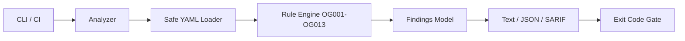

# baysoz-otelgate

[](https://github.com/yazilimbaysoz-svg/baysoz-otelgate/actions/workflows/ci.yml)
[](https://www.python.org/)
[](LICENSE)
[](mailto:baysozlabs@proton.me)

**baysoz-otelgate** is a static policy gate and semantic linter for OpenTelemetry Collector configurations. It catches risky, broken, or insecure collector configs before they reach runtime — without requiring a collector binary, Kubernetes access, or network services.

Built by **Baysöz Labs** (`baysozlabs@proton.me`).

## Why

OpenTelemetry Collector configs are deployment-critical. Real-world failures include configs that pass superficial validation but break at runtime, bind sensitive receivers to all interfaces, disable TLS verification, leak plaintext secrets, or omit memory/batch processors. Existing validation often depends on a specific collector distribution or runtime environment. `baysoz-otelgate` provides a fast, offline, CI-native gate with security and reliability rules.

## Features

- **Safe YAML loading** - duplicate-key detection, SafeLoader-based parsing.
- **Semantic checks** - missing sections, invalid pipelines, undefined component references, unused components.
- **Security checks** - plaintext secrets, `insecure`/`insecure_skip_verify`, exposed `0.0.0.0` endpoints.
- **Reliability checks** - `memory_limiter` ordering, missing `batch` processor hints, telemetry defaults.
- **CI outputs** - human text, JSON, SARIF 2.1.0.
- **Policy gating** - `--fail-on error|warning|never`.

## Install

```bash
uv venv
uv pip install -e .
```

## Usage

```bash
# Show version (includes Baysöz Labs attribution)
otelgate --version

# Scan a config file
otelgate scan configs/otel-collector.yaml

# Scan directory, emit SARIF for code scanning
otelgate scan ./configs --format sarif --output otelgate.sarif

# Fail CI on warnings too
otelgate scan ./configs --fail-on warning

# List rules
otelgate rules
```

## Real CLI Output

```text
$ otelgate --version
otelgate 0.1.0 - Baysöz Labs <baysozlabs@proton.me>

$ otelgate scan tests/fixtures/bad_collector.yaml
tests/fixtures/bad_collector.yaml: ERROR OG004 Pipeline 'traces' references undefined receiver 'missing_receiver' in section 'receivers'.
  suggestion: Define 'missing_receiver' under top-level 'receivers' or fix the reference.
tests/fixtures/bad_collector.yaml: ERROR OG004 Pipeline 'traces' references undefined exporter 'missing_exporter' in section 'exporters'.
  suggestion: Define 'missing_exporter' under top-level 'exporters' or fix the reference.
tests/fixtures/bad_collector.yaml: ERROR OG008 Insecure TLS setting detected at $.exporters.otlp.tls.insecure: insecure=true.
  suggestion: Disable insecure mode and configure proper TLS certificates/verification.
tests/fixtures/bad_collector.yaml: ERROR OG009 Potential plaintext secret at $.exporters.otlp.headers.api_key.
  suggestion: Do not hardcode secrets; use ${ENV_VAR} or a secrets manager reference.
tests/fixtures/bad_collector.yaml: WARNING OG006 Pipeline 'traces' has memory_limiter but it is not first in processors; memory pressure protection may be ineffective.
  suggestion: Place memory_limiter as the first processor in the pipeline.
tests/fixtures/bad_collector.yaml: WARNING OG010 Endpoint $.receivers.otlp.protocols.grpc.endpoint binds to all interfaces (0.0.0.0:4317).
  suggestion: Bind to localhost or a specific private interface unless external exposure is required.
tests/fixtures/bad_collector.yaml: WARNING OG011 Receiver 'otlp' has no explicit auth configuration.
  suggestion: Configure receiver authentication/authorization where supported, especially on non-local endpoints.
tests/fixtures/bad_collector.yaml: INFO OG012 service.telemetry is not configured.
  suggestion: Configure service.telemetry.metrics/logs for collector self-observability.

Summary: 1 file(s), 4 error(s), 3 warning(s), 1 info(s)
Gate: FAIL
Powered by baysoz-otelgate 0.1.0 - Baysöz Labs <baysozlabs@proton.me>
```

## Architecture



See [docs/ARCHITECTURE.md](docs/ARCHITECTURE.md) and [docs/MARKET_RESEARCH.md](docs/MARKET_RESEARCH.md).

## Development

```bash
uv venv
uv pip install -e .
uv pip install pytest ruff
uv run pytest -q
uv run ruff check --select E,F,W,S,B .
uvx semgrep --config p/default --error .
```

## Security

See [SECURITY.md](SECURITY.md). Report vulnerabilities to **Baysöz Labs** at `baysozlabs@proton.me`.

## License

MIT © 2026 [Baysöz Labs](mailto:baysozlabs@proton.me)
